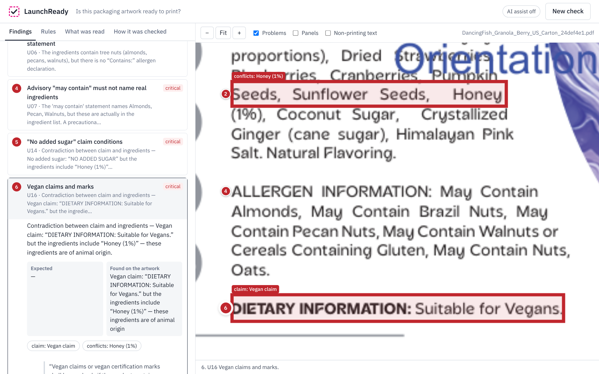
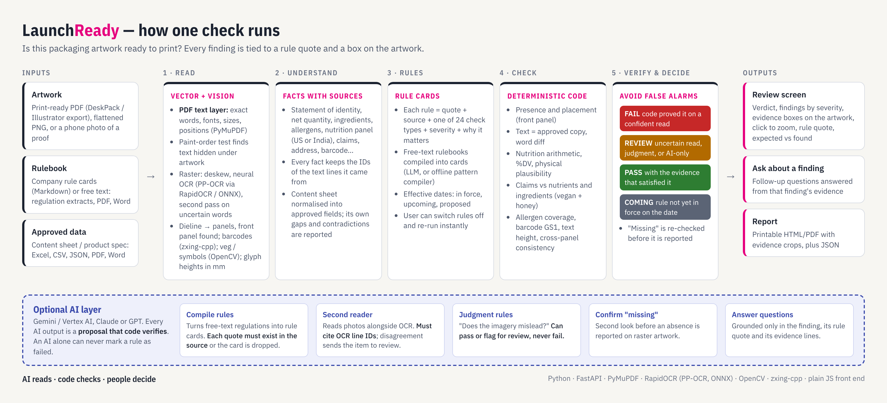

# LaunchReady — is this packaging artwork ready to print?

**Esko AIForge 2026 · Problem statement 2: "Is this Packaging Artwork ready to launch?"**

LaunchReady checks a packaging artwork against a rulebook and the approved product data. It says what is
**definitely wrong**, what **needs a person**, and what **passed**. Every finding quotes the rule it comes
from and draws a box around the evidence on the artwork.

> AI reads · code checks · people decide



---

## 1. The problem

When the design agency delivers final artwork, someone must confirm before print that:

* everything the law and the company require is on the pack, in the right place and at the right size;
* the text and numbers match the **approved product information** (content sheet, spec);
* the claims are true for this recipe ("vegan", "no added sugar", "organic"…);
* the nutrition panel adds up.

Today this is manual proofreading across a PDF, a spreadsheet and a rulebook. It is slow, and the costly
errors are cross-document: an ingredient that contradicts a claim, a number that differs from the
content sheet, an allergen missing from the "Contains" line. A wrong print run means pulping stock or
recalling product. A checker that cries wolf is ignored, so **false alarms matter as much as misses**.

## 2. Our approach

1. **Read the artwork exactly.** Print PDFs have a text layer. LaunchReady reads the real words, fonts,
   sizes and positions with no OCR guessing. It finds the dieline panels and the principal display
   panel, measures character heights in millimetres, decodes barcodes, and detects text hidden under
   other artwork. Photos and flattened images go through neural OCR with a second, independent reading
   of uncertain words.
2. **Turn text into facts with sources.** Statement of identity, net quantity, ingredients, allergen
   statements, the Nutrition Facts panel (US) or nutrition table (India), claims, address, barcode and
   so on. Every fact keeps the IDs of the text lines it came from, so every finding can point at the
   artwork.
3. **Turn the rulebook into rule cards.** Each rule has a verbatim quote, its source, a severity, a
   "why it matters", an optional effective date, and one of **24 deterministic check types**. Free-text
   rulebooks are compiled into rule cards by an LLM (each quote must exist in the source) or by an
   offline pattern compiler.
4. **Check with code, then verify before alarming.** Checks are deterministic: presence and placement,
   word-for-word match with the approved copy, nutrition arithmetic and %DV, claims against nutrients
   and ingredients, allergen coverage, GS1 check digits, text height and consistency across panels.
   Before anything is reported as *missing*, a second look runs: a fuzzy near-miss search and, on
   raster art, a 2× re-scan or an AI second look.
5. **Decide with an explicit policy:**

| Verdict | When |
|---|---|
| **FAIL** (must fix) | Deterministic code found a violation on a confident reading |
| **REVIEW** (needs a person) | The reading is uncertain, the rule needs judgment, or only an AI flagged it |
| **PASS** | Rule satisfied; the evidence that satisfied it is shown |
| **COMING** | Rule not in force on the check date (upcoming company rule, proposed regulation) |

An AI alone can never produce a FAIL.

## 3. Architecture



## 4. What it finds on Esko's sample carton

Inputs: `DancingFish_Granola_Berry_US_Carton_24def4e1.pdf` (DeskPack dieline proof),
`DancingFish_Granola_BerryCrunch_US_Content_Sheet_32057df9.xlsx`, and
`data/rulebooks/us_fda_granola_rulebook.md`. That rulebook has 31 rules: FDA 21 CFR 101, FALCPA and USDA
organic rules, plus stricter company standards.

Result: **Not ready to print — 18 must fix, 4 need a person, 7 passed, 2 coming rules**, in about 10 s.

| Rule | Finding (all with boxes on the artwork) |
|---|---|
| U16 Vegan claims | "Suitable for Vegans" and a Certified Vegan mark, but the ingredients include **Honey (1%)** |
| U14 "No added sugar" | Claimed, but the ingredients include honey, coconut sugar and cane sugar |
| U06 Major allergens | Almonds, pecans and walnuts are in the ingredients, but there is **no "Contains:" statement**, only "May contain" advisory text |
| U07 Advisory statement | The "may contain" text names nuts that are actually ingredients |
| U02 / U03 Net quantity | "480g" is only on the back panel, has no "Net Wt" term and no oz |
| U10 / U12 / U31 Nutrition math | 166 kcal declared vs 535 kcal from 34 g protein, 66 g carbs and 15 g fat; 10 wrong %DVs; 115 g of macronutrients in a 60 g serving |
| U13 / U05 vs content sheet | Carbohydrate 66 g vs 15 g; sodium 23 mg vs 25 mg; Honey (1%) vs (9%), plus other ingredient changes |
| U17 Organic claim | "USDA ORGANIC" with no "Certified organic by …" statement |
| U18 Place of business | "Produced by Dancing Fish Granola Co." with no city, state or ZIP |
| U22 Front-of-pack energy | The 46 kcal icon matches no value in the Nutrition Facts panel |
| U27 Hidden text *(review)* | 19 text lines (an old EU-style "Typical values per 100g" table) are painted over in the PDF. They won't print, but they confuse proofreading tools |
| U19 Barcode *(pass)* | UPC-A 120000000036 scans, check digit valid, matches the content sheet |

The content sheet is checked too. LaunchReady reports **3 problems in the approved data itself**:
total sugars of 18 g exceed total carbohydrate of 15 g, 166 kcal doesn't match the sheet's own
macronutrients, and "Sunflower Seeds" is listed twice. It also shows the 4 open questions written in the
sheet's notes column.

## 5. AI models and technologies

| Part | Technology | Why |
|---|---|---|
| Vector text | **PyMuPDF** text layer: words, fonts, sizes, positions, paint order | Exact; no OCR errors on print files; finds hidden text |
| Raster text | **RapidOCR**: PaddleOCR PP-OCRv3 detection and recognition networks on **ONNX Runtime**, run offline on CPU | Photos, scans and outlined fonts; tiled for small print; second pass on uncertain words |
| Vision | **OpenCV**: dieline and panel detection, veg / non-veg marks, glyph-height measurement in mm; **zxing-cpp** barcode decoding plus a GS1 check-digit verifier | Physical rules (front panel, minimum heights) need geometry, not words |
| Optional LLM | **Google Gemini** (Gemini API or Vertex AI express key), or Claude / GPT | Compiles free-text rulebooks, second reader for photos, judgment rules, confirms "missing" items, answers follow-up questions. Every output is verified (below) |
| Matching | **RapidFuzz** fuzzy matching, word-level diffs | Near-miss search before reporting "missing"; readable diffs |
| App | **FastAPI** backend, plain-JS single-page UI (no build step), printable HTML report | Runs on a laptop with one command |

**How AI output is kept honest**

* **Rule compiler:** the LLM may only map rules onto the fixed check catalogue. Each rule card's quote is
  fuzzy-matched against the source document, and cards whose quote is not found are discarded and
  logged.
* **Second reader:** the AI must cite the OCR line IDs it read. Ungrounded text is rejected.
  Disagreement with OCR lowers confidence, which sends the item to review.
* **Judgment rules** ("does the imagery mislead?"): the AI can pass a rule or flag it for review, never
  fail it. A flag without cited evidence becomes "uncertain".
* **Follow-up questions** are answered only from that finding's rule quote, evidence lines and notes.
* Everything the AI did (accepted, rejected or downgraded) is listed under **How it was checked** in the
  UI. Responses are cached, so demos are repeatable.

Without an API key, every deterministic check still runs and judgment rules go to a person.

## 6. Evaluation: planted defects with known ground truth

`tools/evaluate.py` generates 2 clean artworks and 26 single-defect variants of a fictional product, each
in three forms: vector PDF, 200-dpi PNG, and a simulated phone photo (tilted, blurred, noisy, no scale).
It then counts what was caught and what was falsely flagged.

| Input (28 artworks each) | Errors flagged | …as a definite FAIL | False alarms | "Needs a person" items per file | Seconds per file |
|---|---|---|---|---|---|
| Print PDF (vector) | **26 / 26** | 26 / 26 | **0** | 0.0 | 0.3 |
| PNG, 200 dpi (flattened) | **26 / 26** | 20 / 26 | **0** | 2.8 | 4.3 |
| Phone-style photo (tilted, blurred, no scale) | **26 / 26** | 21 / 26 | **0** | 3.9 | 8.1 |

*Flagged* means every rule the defect breaks is reported as FAIL or REVIEW. A *false alarm* is a FAIL on
a rule that should pass. Full per-artwork detail is in [`eval/results.md`](eval/results.md). On raster
input, some definite failures become reviews by design: when the reading is uncertain, LaunchReady asks
a person instead of guessing.

## 7. Run it

Requires **Python 3.10+** (tested on 3.13). No GPU or internet is needed for the core checks.

```bash
# macOS / Linux
./run.sh            # first run creates .venv and installs requirements
# Windows
run.bat
```

Or manually:

```bash
python -m venv .venv
.venv/bin/pip install -r requirements.txt        # Windows: .venv\Scripts\pip ...
.venv/bin/python -m uvicorn app.main:app --port 8000
```

Open **http://localhost:8000**, pick **"Esko sample — Dancing Fish Granola, US carton"** and press
**Run check**.

**Switch AI assist on (optional):** copy `.env.example` to `.env` and set `GEMINI_API_KEY=` to your key.
Both `AIza…` Gemini API keys and `AQ.…` Vertex AI express keys are supported. `ANTHROPIC_API_KEY` or
`OPENAI_API_KEY` also work. Run `python tools/check_ai.py` to confirm the key works, then restart the
app. The header pill shows "AI assist on".

**Tests and evaluation:**

```bash
python -m pytest -q                          # 23 tests: units, AI guardrails, samples end to end, HTTP API
python tools/evaluate.py --forms pdf,png,photo
```

## 8. Use your own files

* **Artwork:** PDF (vector or outlined), PNG, JPG, TIFF or WEBP. Multi-page PDFs are supported (first 6
  pages).
* **Rulebook:** Markdown rule cards (see `data/rulebooks/*.md`; each `## ID — Title` section has
  **Rule**, **Basis**, **Why it matters** and a `rule` YAML block), YAML or JSON, or a free-text
  PDF / Word / TXT file, which is compiled into rule cards.
* **Approved data:** a content sheet in Excel (field/value layout, as in Esko's sample), CSV, JSON, or a
  spec document in PDF / Word.
* **Check date:** choose "rules in force on" to see how upcoming or proposed rules would affect the
  artwork.

## 9. Project layout

```
app/
  extract/   artwork.py (PDF/image loading, panels) · pdf_text.py (text layer, hidden text)
             ocr.py (RapidOCR, tiling, re-read) · vision.py (marks, barcodes, glyph height)
  facts.py   text lines -> facts with source line IDs (US and India formats)
  approved.py content sheet / spec -> approved fields, plus its own consistency warnings
  rules/     rulebook.py (rule cards, free-text compiler) · checks.py (24 check types) · engine.py (verify + verdict policy)
  ai.py      every LLM use and the verification around it · llm.py (Gemini / Vertex / Claude / GPT client, cache)
  pipeline.py, main.py (FastAPI), report.py (printable report)
web/         single-page UI (HTML/CSS/JS, bundled IBM Plex fonts)
data/        samples (Esko's files + synthetic), rulebooks (US FDA, India FSSAI)
tools/       evaluate.py (planted-defect evaluation), labelgen.py, make_samples.py, check_ai.py
tests/       pytest suite
docs/        architecture diagram, screenshots
```

## 10. Limitations and next steps

* Rulebooks shipped here are **illustrative interpretations** written for the demo. Thresholds marked
  "company standard" or "proposed" are not legal advice and must be verified against the official text.
* The fact extractors cover food labels (US Nutrition Facts, Indian FSSAI tables). Other categories,
  such as cosmetics or pharma, need new extractors; the rule and verdict engine is generic.
* Raster input gets more "needs a person" items by design. Print PDFs give exact results.
* Next steps: compare against the previous approved artwork version (what changed?), multi-language
  panels, a WebCenter / Comply integration point (run on artwork upload, post findings as annotations),
  and learning from reviewer decisions to tune confidence thresholds.

---

Synthetic test artworks use a fictional brand (Sunfield) with fictional licence numbers and barcodes.
Esko's sample files are used as supplied for the AIForge challenge.
